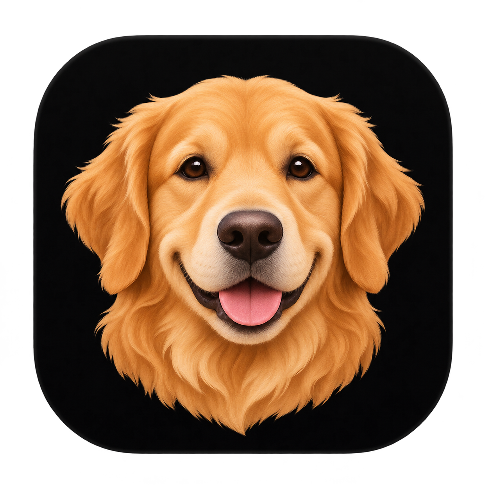
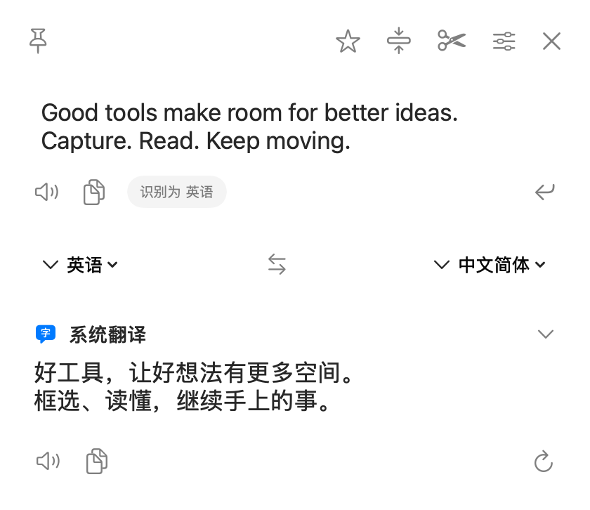
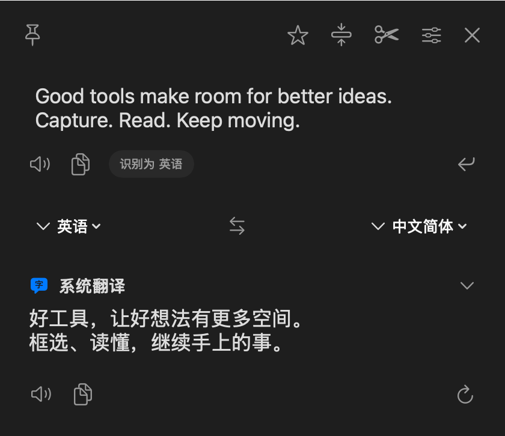

<p align="center">
  
</p>

<h1 align="center">DAX</h1>

<p align="center"><strong>框选屏幕，读懂文字。</strong></p>
<p align="center">常驻 macOS 菜单栏的截图识别与翻译工具。</p>

<p align="center">
  
  
  
</p>

<table>
  <tr>
    <td align="center"></td>
    <td align="center"></td>
  </tr>
  <tr><td align="center">浅色模式</td><td align="center">深色模式</td></tr>
</table>
<p align="center"><sub>应用界面 · 示例内容</sub></p>

## 日常够顺手

- **截图即识别** — 启动时整屏蓝色描边，拖动框选，松手识别并显示译文。
- **多种输入** — 划词、手动输入、剪贴板和图片，按当前场景选择。
- **本地 OCR** — 识别中英文、连续截图追加文字，也能读取二维码。
- **图片翻译** — 编辑识别区域、局部重译、切换原图并导出。
- **结果随手用** — 复制、朗读、置顶、收藏，历史记录可检索。
- **跟随系统** — 原生浮窗、浅色与深色外观、自定义快捷键。

## 三步开始

1. 从菜单栏打开 DAX，按系统提示授予屏幕录制权限。
2. 按截图快捷键，看到屏幕四周的蓝框后拖动选区。
3. 松手查看识别文字和译文，按 **Esc** 取消截图或关闭结果。

截图翻译默认使用 **⌃⌥S**，可在「设置 → 通用」改为 **⌥2** 等组合。首次使用系统翻译时，按提示下载语言资源。

## 从源码构建

准备 macOS 15 或更新版本，以及 Xcode Command Line Tools。

```bash
git clone https://github.com/LECoO21/DAX.git
cd DAX
swift build
```

当前提供开发版源码，打包为可安装应用需要配置自己的代码签名。

---

使用体验参考 [Bob](https://github.com/ripperhe/Bob)，基于公开资料独立实现。第三方组件的许可证随源码保留。
